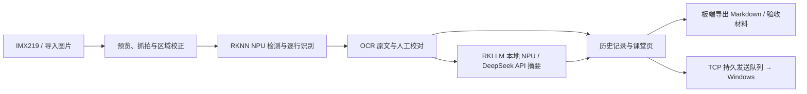

# 工程说明与报告索引

## 数据流

## 各章节如何对应实现

| 报告章节 | 可以引用的实现 |
| --- | --- |
| 采集与图像预处理 | [camera.py](../camera.py) 用后台线程读取 V4L2 最新帧。[image_processing.py](../image_processing.py) 对四角选区做透视校正，[auto_capture.py](../auto_capture.py) 检查画面清晰度、稳定时间和相似页面。 |
| 整页 OCR | [ocr_engine.py](../ocr_engine.py) 通过 RKNN Lite 依次调用 PP-OCRv4 检测和识别。OpenCV 负责裁切和透视变换，[reading_order.py](../reading_order.py) 负责阅读顺序。识别原文、框线图和 OCR 输入可由 [page_evidence.py](../page_evidence.py) 导出。 |
| 摘要与人机交互 | [summary_controls.py](../summary_controls.py) 绑定来源、模型与进度。[npu_summary.py](../npu_summary.py) 调用 RKLLM C++ 启动器，[deepseek_summary.py](../deepseek_summary.py) 用 Python 标准库 HTTP 客户端处理可选云端请求。修改原文后可重新生成。 |
| 相册、历史和课堂 | [capture_album.py](../capture_album.py) 支持多选识别、存历史、加入课堂与撤销删除。[records.py](../records.py) 管理同页多来源记录。[collections_store.py](../collections_store.py) 保存页序、摘要和来源快照。追加或修改页后，已有摘要仍对应生成时的来源。 |
| TCP 通信与恢复 | [tcp_transport.py](../tcp_transport.py) 使用四字节网络序长度和 UTF-8 JSON。[receiver.py](../receiver.py) 写盘后回复记录编号及修订标识。[outbox.py](../outbox.py) 保存待发队列，收到匹配的确认后移除。 |
| 测试与问题分析 | 单元和 GUI 回归可查看 `test_*.py`。截图、识别差异和耗时可从现场实测及导出材料获取。报告中分别标注测试所用的模型来源、样本和运行环境。 |

## 已验证的板端流程

- IMX219 实际捕获 1920×1080 帧，确认过自动采集图片保存和相册读取。对既有实拍页做回放时，另外覆盖了轻微晃动、翻页和重复页。
- 两张实拍 PPT 在板端完成 NPU 批量 OCR 和 Qwen3-4B 综合摘要。另用板上相册数据副本验证两页加入课堂、工作台追加第三页后重新生成，以及结果对三页的引用。
- 做过板端到 Windows 的实际 TCP 保存确认。接收端可选择文件夹并保存 JSON 和 Markdown。测试记录和截图通过组内渠道取用。
- 图形回归中的替身后端用来验证按钮、编辑态和错误处理。现场摄像头、真实 API 与性能数据使用各自的实测结果。

## 复现说明

课程讲义、幻灯片实拍原图、板端个人历史和运行日志有独立来源。报告引用它们时，从本组授权的验收材料补充。模型和运行时的版本、文件位置见 [README](../README.md)。
