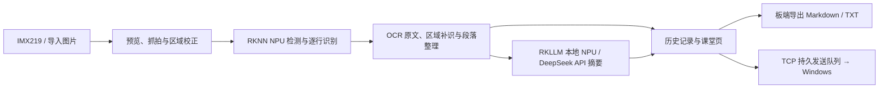

# 工程说明与报告索引

## 数据流

## 各章节如何对应实现

应用层用 Python 编排界面、图像采集、摘要请求、存储和通信。PP-OCR 经过 RKNN Lite 调用 NPU。本地语言模型由 C++ 程序调用 RKLLM，Python 负责启动子进程、读取输出和显示速度。

| 报告章节 | 可以引用的实现 |
| --- | --- |
| 采集与图像预处理 | [camera.py](../board_app/capture/camera.py) 用后台线程读取 V4L2 最新帧。[image_processing.py](../board_app/ocr/image_processing.py) 对四角选区做透视校正，[auto_capture.py](../board_app/capture/auto_capture.py) 检查画面清晰度、稳定时间和相似页面。 |
| 整页 OCR | [ocr_engine.py](../board_app/ocr/ocr_engine.py) 通过 RKNN Lite 依次调用 PP-OCRv4 检测和识别。OpenCV 负责裁切和透视变换，[reading_order.py](../board_app/ocr/reading_order.py) 负责阅读顺序。[page_evidence.py](../board_app/storage/page_evidence.py) 保存识别原文、检测框图和 OCR 输入。 |
| 区域补识与段落整理 | [app.py](../board_app/app.py) 将预览中选定的矩形映射回原图，裁切后复用 OCR 引擎。[review_workflow.py](../board_app/ui/review_workflow.py) 在工作台提供预览和确认。[review_format.py](../board_app/summary/review_format.py) 只采用本地模型返回的合并行号，再由 Python 拼接原文字行，保留词句、数值和标点。 |
| 摘要与人机交互 | [summary_controls.py](../board_app/ui/summary_controls.py) 绑定来源、模型与进度。[npu_summary.py](../board_app/summary/npu_summary.py) 调用 RKLLM C++ 启动器，[deepseek_summary.py](../board_app/summary/deepseek_summary.py) 用 Python 标准库 HTTP 客户端处理可选云端请求。修改原文后可重新生成。 |
| 相册、历史和课堂 | [capture_album.py](../board_app/ui/capture_album.py) 支持多选识别、存历史、加入课堂与撤销删除。[records.py](../shared/records.py) 管理同页多来源记录。[collections_view.py](../board_app/ui/collections_view.py) 提供生成模型和已保存摘要选项。[collection_summary.py](../board_app/summary/collection_summary.py) 分批处理长课件、校验引用，漏页时用对应来源单独补生成。[collections_store.py](../board_app/storage/collections_store.py) 保存页序、摘要和来源快照。 |
| TCP 通信与恢复 | [tcp_transport.py](../shared/tcp_transport.py) 使用四字节网络序长度和 UTF-8 JSON。[receiver.py](../windows_receiver/receiver.py) 写盘后回复记录编号及修订标识。[outbox.py](../board_app/outbox.py) 保存待发队列，收到匹配的确认后移除。 |
| 测试与问题分析 | 单元和 GUI 回归可查看 [tests/](../tests/)。现场截图见 [截图和图注](screenshots/README.md)，报告中分别标注所用的模型来源、样本和运行环境。 |

## 已验证的板端流程

- IMX219 实际捕获 1920×1080 帧，确认过自动采集图片保存和相册读取。对既有实拍页做回放时，另外覆盖了轻微晃动、翻页和重复页。
- 两张实拍 PPT 在板端完成 NPU 批量 OCR 和 Qwen3-4B 综合摘要。另用板上相册数据副本验证两页加入课堂、工作台追加第三页后重新生成，以及结果对三页的引用。
- 同一台 ROCK 5C 上用 Qwen3-4B 对 7 页课堂生成了 10 条要点，覆盖 P1 至 P7，约用时 93 秒。保存后重新读取并核对页码。
- 使用一页保存的实拍 OCR 验证段落整理。课堂来源窗口将 12 行整理为 8 行，字词、数字和标点保持一致，可以切回原始换行。工作台也验证了预览后应用。
- 做过板端到 Windows 的实际 TCP 保存确认。接收端可选择文件夹并保存 JSON 和 Markdown。测试记录和截图通过组内渠道取用。
- 图形回归中的替身后端用来验证按钮、编辑态和错误处理。现场摄像头、真实 API 与性能数据使用各自的实测结果。

## 复现说明

课程讲义、幻灯片实拍原图、板端个人历史和运行日志有独立来源。报告引用它们时，从本组授权的验收材料补充。模型和运行时的版本、文件位置见 [README](../README.md)。
